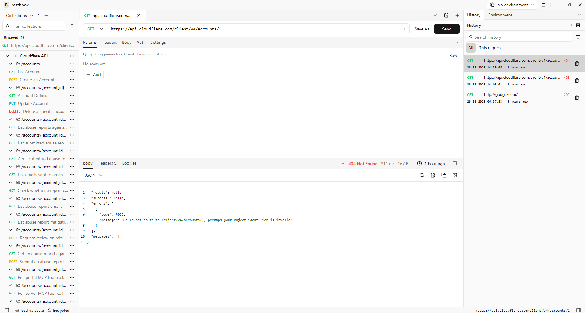

<p align="center">
  
</p>

<h1 align="center">restbook</h1>

<p align="center">
  A local-first desktop HTTP client: Postman's concepts, no account, no cloud,
  and every request you send saved to an encrypted local history.
</p>



restbook exists for the case where signing in to an API client is the thing you
do not want to do. It is small and finished on purpose — local-first and encrypted
by default, GUI-first but text-friendly, and limited to HTTP.

## What you get

- **Send requests** — GET, POST, PUT, PATCH, DELETE, HEAD, OPTIONS from a URL bar
  with Params, Headers, Body (raw JSON/XML/HTML/text, or form-urlencoded) and
  Auth (basic, bearer, API key).
- **Encrypted history by default** — every request and response in one SQLCipher
  database, keyed from the OS keyring. No account, no telemetry, and no plaintext
  fallback without saying so.
- **Collections and environments** — nested folders, `{{variables}}` with scope
  precedence, and secrets redacted from anything shareable.
- **A workspace you can commit** — point restbook at a folder with a
  `restbook.json` marker and collections and environments become Git-friendly
  files; history stays local and encrypted.
- **Import and export** — import Postman v2.1, OpenAPI 3, HAR, and cURL; export
  back to Postman and OpenAPI JSON.
- **Text in, text out** — paste a cURL command to build a request, copy one back
  out; every URL and body is a plain string you can select.
- **Keyboard first** — `Ctrl+Enter` to send, a command palette, and a full
  shortcut table in [`docs/12-keyboard-shortcuts.md`](docs/12-keyboard-shortcuts.md).

## Quick start

The engine (no window, no GPUI):

```sh
cargo build
cargo run -p restbook-devcli -- send https://httpbin.org/get
cargo run -p restbook-devcli -- history httpbin
```

The desktop app (its own Cargo workspace):

```sh
cd crates/app
sh ../../scripts/dev.sh run
```

On Windows without `sh`, use `..\..\scripts\dev.ps1 run` or
`..\..\scripts\dev.cmd run`. A fresh Windows machine runs
`.\scripts\setup-windows.ps1 -Install` once first; macOS and Linux install the
packages listed in [`docs/06-cross-platform.md`](docs/06-cross-platform.md).

The encrypted build needs an OpenSSL dev tree, which the `dev` scripts detect.
`--no-default-features` drops SQLCipher and writes plaintext history instead —
useful for a first build, but a mode you should know you are in.

## Documentation

| If you want to… | Read |
|---|---|
| know what restbook will and will not do | [`docs/00-scope.md`](docs/00-scope.md) |
| see what ships when | [`docs/01-milestones.md`](docs/01-milestones.md) |
| understand the window and its panes | [`docs/02-ui-plan.md`](docs/02-ui-plan.md) |
| understand the engine, pipeline, and storage | [`docs/03-backend-plan.md`](docs/03-backend-plan.md) |
| change the engine | [`docs/04-backend-guide.md`](docs/04-backend-guide.md) |
| change the desktop shell | [`docs/05-ui-guide.md`](docs/05-ui-guide.md) |
| build on macOS, Linux, or Windows | [`docs/06-cross-platform.md`](docs/06-cross-platform.md) |
| find where a click or command lands | [`docs/07-flows.md`](docs/07-flows.md) |
| see the known rough edges | [`docs/08-qol-backlog.md`](docs/08-qol-backlog.md) |
| check a deliberate GPUI Kit deviation | [`docs/09-gpui-kit-audit.md`](docs/09-gpui-kit-audit.md) |
| release or update a build | [`docs/10-release-and-updates.md`](docs/10-release-and-updates.md) |
| navigate the repository | [`docs/11-repo-map-and-dev-cycle.md`](docs/11-repo-map-and-dev-cycle.md) |
| look up a keyboard shortcut | [`docs/12-keyboard-shortcuts.md`](docs/12-keyboard-shortcuts.md) |
| learn the Rust used here | [`docs/13-rust-primer.md`](docs/13-rust-primer.md) |
| report a vulnerability | [`SECURITY.md`](SECURITY.md) |

## License

MIT or Apache-2.0, at your option: [`LICENSE-MIT`](LICENSE-MIT) and
[`LICENSE-APACHE`](LICENSE-APACHE). Contributions are accepted under the same
pair.
